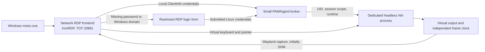

# Architecture and delivery gates

The target is a login-independent remote desktop: the PC remains awake, a
system-level broker can create a session without a local user session, and a
dedicated Niri process renders a virtual output while the physical display is
off or disconnected. This is feasible as an integration project, but the full
path is not provided by stock Niri today. Evidence and exact upstream gaps are
in [Niri findings](niri-findings.md); authentication and library choices are in
[login and RDP research](login-and-rdp.md).

The frontend owns TLS, library-managed RDP negotiation, codecs, input callbacks,
and limits. The privileged broker owns account authorization and session
lifetime; it accepts no arbitrary executable or environment supplied by clients.
The compositor owns output rendering and input routing. The bridge uses the
session's explicit Wayland and Niri IPC sockets, never inherited local desktop
sockets. The virtual output remains powered and scheduled when physical outputs
are absent; this does not require turning off or changing the local desktop.

## Phases

| Phase | Work | Acceptance gate | Current evidence |
| --- | --- | --- | --- |
| 0: isolated foundations | Synthetic RDP display using a reusable server library; private current-UID worker environment and cleanup | Compile and run automated frame/input/policy tests; no public bind or host configuration changes | See [validation](validation.md) for completed checks and remaining interop tests |
| 1: Niri headless backend | Evaluate existing virtual-output PRs in an isolated checkout/VM; add explicit headless startup, default output, render clock and bounded resize | Niri starts without DISPLAY/WAYLAND_DISPLAY, VT, DRM master or physical outputs; capture a changing test app at a known resolution | Pinned patched PR3953 built; native client-selected initial size and repeated portrait/landscape resizing passed with SHM/input in disposable Arch namespace |
| 2: desktop bridge | SHM capture into library bitmaps; virtual keyboard/pointer input with correct keymap, scancode, coordinates and disconnect release | `mstsc.exe` renders an app and its input changes that app; repeat with physical outputs absent and later powered off | Real FreeRDP/Niri application roundtrip passes; mstsc and physical-monitor gates pending |
| 3: real remote login | Separate broker, dedicated test PAM policy, remote seatless logind session, account limits and rollback | Fresh VM boot, no local login: valid credentials create a remote Wayland Niri session; invalid credentials and launch/crash failures leave no resources | Native PAM/logind broker implemented/tested with fake PAM; actual system session and fresh-boot acceptance pending |
| 4: desktop completion | Reconnect, resize, multiple distinct UIDs, session service integration, optional audio/clipboard, packaging | Windows compatibility matrix, power-off/unplug regression, resource limits and session teardown; explicit same-UID policy | Pending |

Experimental packaging is prepared for separate-machine testing while the
unperformed phase 2/3 gates remain open. Package availability does not promote
those gates to complete. See [installation](install.md), [acceptance](acceptance.md)
and the component checkpoints for exact sources and executed evidence.

Keep phase 1–3 integration in a disposable Arch VM with a dedicated account.
Do not replace the host's Niri package, GDM, GRD, PAM stack, or working desktop.
Software/surfaceless rendering is the first fallback; GPU rendering through a
render node is an optional later path. Validate render-node access under the
remote session UID; a seatless session must not assume local-seat device ACLs.
Display independence must not depend on seat0 being active. The eventual boot service is a system service; starting a
user service or enabling linger alone is not equivalent to opening a login
session.

Monitor power-off is distinct from system suspend. Test display power and
disconnect while the disposable machine stays awake; the current host's power
policy remains untouched.

## Upstream boundary

Niri should provide a supported headless backend and virtual-output lifecycle,
not an embedded RDP implementation. Reuse its existing capture and virtual input
protocols first. Extend output creation/removal/resize and capability discovery
where missing. Test frame scheduling, no-output operation, scale/transform,
hotplug independence, rendering failure, and capture cancellation upstream.
DMA-BUF support can follow a working SHM baseline; unsupported buffers must
return errors rather than panic. Existing virtual-output PRs are starting points
for review, not merged functionality or validated deployments.

An external broker can supply PAM/logind and account policy without changing
GNOME/GDM. IronRDP's inspected development source already has credential
validation and post-authentication desktop binding; verify the chosen release
before depending on those APIs. Keep FreeRDP as an alternative if a measured
Windows/security requirement makes it preferable. Upstream RDP work should be
driven by a failing interoperability test, rather than recreating protocol code.

## Authentication and session policy

Use one dedicated account for the first real desktop test and initially reject
accounts with another graphical session. Per-session private D-Bus and unique
sockets help, but `/run/user/$UID`, the systemd user manager, user files, portals,
PipeWire and application single-instance behavior need explicit handling. A
second desktop under the same UID is not independent security isolation.

NLA/CredSSP authentication and PAM password checks are distinct mechanisms.
Choose the library's supported NLA/SSPI backend or explicitly test TLS-only RDP
and its client requirements in the VM. Do not assume accepting a PAM password
provides NLA or arbitrary PAM conversations. The PoC's disposable credentials
are not Linux account credentials. Disposable test mode remains loopback-only.
The installed broker frontend defaults to a direct network listener at
`0.0.0.0:33991`; an explicitly configured loopback listener remains available.
Missing passwords or remembered Windows domain credentials open a restricted
login form. Only PAM acceptance creates a Linux desktop/session. Real Windows
TLS fallback and installed-host PAM/logind acceptance remain pending.

